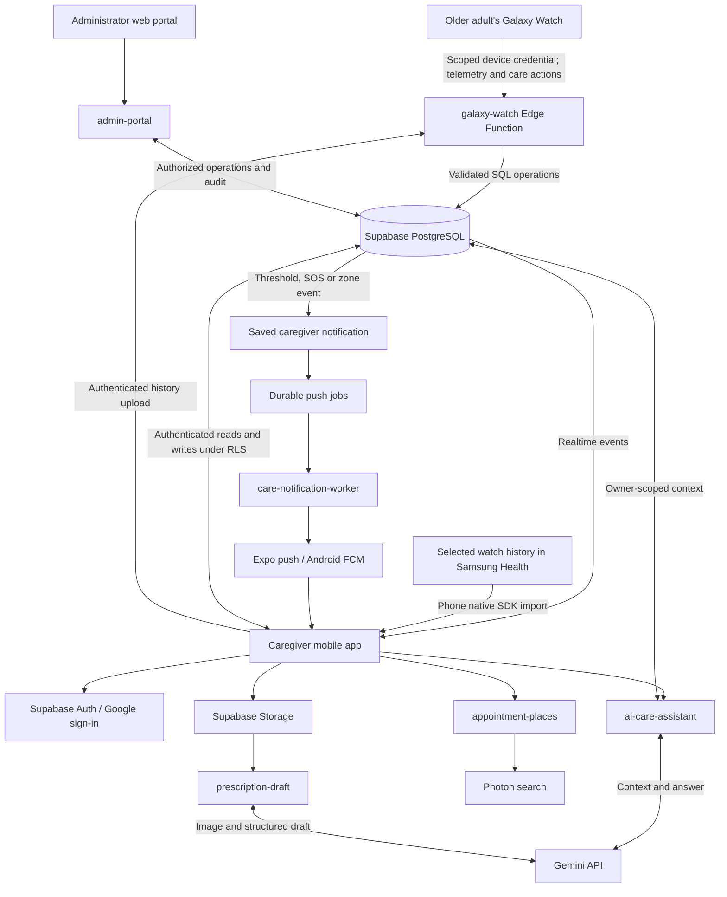

# ElderCareAI: An AI-Driven IoT System for Elderly Monitoring and Caregiver Support — System Guide for Defense

## 1. Executive Overview & Problem-Solution Fit

**Purpose.** ElderCareAI brings watch readings, location estimates, care schedules, alerts and patient context into one caregiver application. Its goal is to help caregivers notice information that needs review and coordinate follow-up.

**Problem.** A caregiver may otherwise need to check separate health records, ask about medication, track appointments and contact the older adult without a shared view of recent information. Delayed synchronization and missing readings also make it difficult to distinguish an actual new measurement from an old value.

**Solution.** A native Galaxy Watch companion collects supported measurements and uploads them to Supabase. The caregiver app displays their original times and sources, manages care records, and receives saved alerts. Elle uses authorized database context to assist with questions and summaries. An administrator portal manages accounts and reviews operational records.

| Role | Main responsibility |
|---|---|
| Caregiver | Sign in, maintain the linked patient profile, pair the watch, review readings, manage care schedules and respond to alerts. |
| Older adult / watch wearer | Wear the paired watch, start monitoring, request help through SOS and report a scheduled dose as Taken. A separate patient mobile login is not established by the reviewed workflow. |
| Administrator | Use a separately authorized web account to manage access, inspect records, export reports and review administrative history. |
| Doctor / emergency contact | Be recorded as a contact and reached through the phone interface. A doctor login or hospital integration is not established. |

**Defense summary:** “ElderCareAI supports caregiver awareness and coordination using watch telemetry, explicit care workflows and AI-assisted explanations. It does not diagnose disease, verify medication ingestion or guarantee emergency response.”

**Evidence baseline.** This guide was prepared on 27 November 2026 from the repository at commit `9bb0dd4` and the preceding verified deployment work. The 26 November release records show the fast safe-zone backend migration and a compatible Android preview update. Preparing this guide did not repeat a live system or physical-device acceptance test. The academic program and official defense stage still require confirmation.

## 2. System Architecture & Tech Stack

### Components and technology rationale

| Component | Verified implementation | Why it fits this project |
|---|---|---|
| Caregiver app | TypeScript, React Native 0.81, Expo SDK 54 and Expo Router | Provides mobile screens, navigation, notification handling, reports and access to native modules within one application. |
| Watch companion | Native Kotlin / Wear OS, Samsung Health Sensor SDK and Android/Google Play services location | Gives the watch direct access to its supported sensors, local reminders, location providers and persistent upload queue. |
| Health-history bridge | Local Expo native module using Samsung Health Data SDK on the phone | Imports selected-watch sleep and oxygen history that the continuous live sensor path does not provide. |
| Authentication | Supabase Auth; Google OAuth for caregivers; separate email/password admin flow | Separates identity verification from application roles and account status. |
| Database | Supabase PostgreSQL, SQL functions, constraints, triggers and Row Level Security (RLS) | Stores relationships and durable events, checks ownership and supports atomic operations and retry protection. |
| Backend application logic | Supabase Edge Functions using Deno/TypeScript | Keeps privileged operations and provider credentials on the server. This is not a separate Express/Node.js backend. |
| Live updates | Supabase Realtime plus foreground reconciliation | Updates connected screens while providing a polling/reload path when an event is missed. |
| File storage | Supabase Storage | Holds prescription/care files and profile images, with different access rules for those buckets. |
| AI services | Gemini requests from the server; local statistical health-analysis functions | Supports contextual explanations and image-to-draft extraction while keeping threshold detection independent of generative AI. |
| Location interface | Leaflet in a WebView, OpenStreetMap tiles, Photon place search | Shows received positions and saved circles and supports appointment destination selection. |
| Notifications | Local phone/watch reminders; durable server push jobs; Expo push and Android FCM configuration | Supports scheduled reminders and remote alerts. Provider acceptance and actual device display remain separate outcomes. |
| Web and release delivery | Static HTML/CSS/JavaScript website and admin portal on Vercel; EAS Android builds and compatible preview updates | Supports website access and controlled delivery of the phone application. |

### Request and data flow

The app also loads external map resources. Those resources are separate from the database's stored coordinates and the safe-zone calculation.

### Implemented backend interfaces

The following are Supabase function names, reached through `/functions/v1/<function-name>`; they are not invented REST resources.

| Function | Main operations and authorization |
|---|---|
| `galaxy-watch` | `POST` with actions including `pair`, `claim`, `ingest`, `care`, `disconnect`, `link_samsung_health`, `unlink_samsung_health` and `import_samsung_health`. Care operations include `sync`, `sos` and `medication_taken`. The handler distinguishes caregiver JWTs from scoped device credentials. |
| `ai-care-assistant` | Authenticated caregiver question or metric insight, with server-side role, ownership and chat-session checks. |
| `prescription-draft` | `POST` with patient ID and private image path; verifies the caregiver, patient ownership, file path, format and size before extraction. |
| `appointment-places` | `POST` with a submitted search query and optional map center; requires an active caregiver. |
| `admin-portal` | Authorized actions for session checks, dashboard, accounts, monitoring, alerts, reports and administrative changes. The browser does not receive the service-role key. |
| `care-notification-worker` | Server-only push processing authenticated with the worker key. It is not a public caregiver API. |

Gateway JWT verification is deliberately disabled for the watch and worker functions because they use other credentials. Their handlers still authenticate requests. Do not describe those endpoints as unauthenticated.

## 3. Core Modules & End-to-End Workflows

### A. Caregiver authentication and onboarding

1. The caregiver selects Google sign-in.
2. Supabase starts the OAuth flow; the mobile callback uses `eldercareai://auth/callback` and the configured PKCE flow.
3. The app restores the session and reads saved onboarding progress.
4. The caregiver completes the introduction, caregiver information, older-adult information, watch setup and location consent/permission steps.
5. Completed progress routes the user into the app. Cancelling sign-in or denying a permission does not fabricate a completed connection.

**Inputs:** authenticated identity, profile details and permission decisions. **Outputs:** a persisted session, owned profiles and onboarding state. An identity alone does not grant administrator privileges.

### B. Watch pairing, live measurements and synchronization

1. An active caregiver creates an eight-digit pairing code. The reviewed implementation gives it a ten-minute validity period.
2. The watch submits the code. A successful claim consumes it and creates a patient-scoped device registration.
3. The server returns a device credential; the database stores its SHA-256 hash. The caregiver app cannot read the hash through its granted device columns.
4. The wearer starts monitoring and grants the needed permissions.
5. Valid delivered vital events enter the watch's persistent SQLite outbox. Uploads use bounded batches, with a maximum of 120 samples.
6. The backend validates credentials, payloads and timestamps, records new samples and updates each metric's current value independently.
7. The caregiver receives database changes through Realtime and foreground refresh paths.

**States:** unpaired → paired → monitoring; uploads may be pending, accepted or rejected. A connected watch can still have missing sensors, an old position or an unsent queue.

Retries use stable sample identities and database uniqueness. A repeated upload must not create another copy of the same measurement. An older delayed sample can remain historical without replacing a newer live measurement.

| Data | Collection and interpretation |
|---|---|
| Heart rate | Continuous delivered events while monitoring, with a platform fallback where available. |
| Wrist skin temperature | Supported Samsung tracker; depends on valid contact and is not core body temperature. |
| HRV | RMSSD estimated from usable beat intervals; insufficient or poor-quality intervals produce a waiting state. |
| Steps | Increments recorded during monitoring periods for the day; not necessarily the wearer's complete daily steps. |
| SpO₂ | Manual or foreground automatic spot checks; automatic checks require the oxygen screen to remain open. Imported history is a separate path. |
| Sleep | Imported after Samsung Health has recorded and synchronized the selected watch's sessions. |
| Location | GPS, fused or network estimate with original source, time and reported accuracy. |

### C. Samsung Health history import

The caregiver grants phone-side access, explicitly selects the patient's Samsung Health source and starts synchronization. The phone reads permitted sleep/oxygen records and submits bounded batches through `galaxy-watch`. The backend checks the source link and ownership before storing them. Retried imports retain record identity and do not become new independent observations.

**Expected states:** not linked, permission needed, source linked, importing, imported or retry/error. Background execution is OS scheduled; it is not a guaranteed immediate or fixed-interval transfer.

### D. Live location and safe-zone estimation

The map chooses the newest received estimate across the route and live-state streams. The live marker retains that estimate's actual coordinates, time and accuracy; filtering of the historical trail must not pin the live marker to an old position.

The caregiver saves a fixed center, name and radius. The supported radius is 10–5,000 m. Saving the circle begins a new check; movement of the marker does not move the saved center.

**Current fast-exit policy, from the 26 November migration:**

- GPS, fused and network estimates can qualify, including switches between those sources.
- Estimates must pass freshness, ordering, device-monitoring and validity checks. Reported accuracy must be within the supported 0–2,000 m range.
- Two qualifying outside readings spanning at least two seconds confirm an estimated exit. A single outside reading does not alert.
- Distance is calculated from the stored center using the coordinates; the exit boundary matches the saved radius.
- Returning requires three inside readings spanning at least ten seconds, inside a small inset. This reduces repeated alerts around the edge.
- Implausible-jump filtering, event deduplication and checks against obsolete queued notifications remain in place.

**States:** unknown → confirming → inside/outside; paused monitoring and stale data must remain visible as such. The alert identifies an estimated crossing, its location source and reported accuracy.

**Defense boundary:** two seconds is the minimum span between qualifying measurements, not a promise that a phone notification appears two seconds after physical movement. A 10 m circle can be much smaller than network uncertainty. Fused location may represent the paired phone, including a phone left behind.

### E. Alerts, SOS and caregiver response

New accepted readings can cross configured patient review thresholds. Database rules save the resulting health alert and caregiver notification. Watch SOS is an explicit confirmed user action that saves an emergency event, critical alert and caregiver notification after successful backend acceptance.

Saved notifications can enqueue durable push jobs. A database event attempts to wake the worker; scheduled retry processing remains available if dispatch fails. The worker claims jobs, submits push requests and checks later receipts. A dispatch problem must not roll back the already accepted measurement or saved alert.

The foreground app also observes notices and suppresses duplicate presentation. An owner-authorized caregiver can acknowledge an alert or resolve it with a note. Response history records those actions; the reviewed database rules prevent reopening a finalized resolution or rewriting its final note.

**Distinguish:** watch action pending → server records saved → push submitted → provider receipt → actual phone presentation → caregiver response. These are separate stages. SOS does not automatically contact emergency services. Contact buttons open the phone's calling interface.

### F. Medication, appointment and note management

The caregiver creates or edits schedules, appointments and notes in Care. Phone reminders and synchronized watch medication reminders depend on permissions, device time and the last received schedule. Edits/cancellations update the relevant reminder paths; a disconnected watch may still hold its older cached schedule.

For a medication confirmation, the user selects the actual scheduled dose. The backend validates the dose against the schedule and permitted timing. A unique schedule/dose identity prevents phone/watch retries from logging it twice. Offline watch confirmations remain pending until accepted.

**Output:** a scheduled item and, when reported, a dose-level medication log. “Taken” records a person's report; the system cannot independently verify swallowing or clinical adherence.

### G. Prescription extraction and reviewed saving

1. The caregiver selects a prescription image, with optional supported crop/rotation.
2. The app uploads it to the private `care-files` location for that caregiver and patient.
3. `prescription-draft` validates ownership and accepts supported JPG/PNG/WebP images up to 10 MB.
4. Gemini returns a structured draft; uncertain or unreadable information should remain flagged or blank.
5. The caregiver checks every drug, dose, date, frequency and reminder time against the original prescription. Issue date and treatment start date remain separate.
6. `save_prescription_group` saves the reviewed group in one transaction. A stable request/import ID permits a safe retry after a lost response.

**States:** uploaded → extracting → draft requiring review → saved, or extraction/save error. Extraction alone does not create medication schedules. A failed group validation rolls back the group. Manual entry remains available.

### H. Statistical analysis and Elle

The Health module includes deterministic insights, threshold checks and simple statistical projections. The projection uses up to 14 recent comparable values and requires at least four; it fits values against observation order. Its Low/Moderate/High label is a code heuristic based on sample count and fit, not a clinically calibrated probability. Personal-baseline anomaly checks include minimum sample and change requirements.

Elle follows a different path: the server verifies the caregiver and requested chat session, retrieves authorized patient context, and constructs a bounded prompt with source-reading references. Supported factual history queries can use database aggregates and a deterministic response rather than Gemini. Other requests use a configured Gemini model with retry/fallback handling. Returned reading references must correspond to retrieved evidence.

The project integrates an existing model; the reviewed implementation does not train a custom medical language model. Prompt instructions prohibit diagnosis, prescribing and dose changes, but they cannot guarantee that every generated answer is correct.

## 4. Database & Data Flow Summary (If Applicable)

### Main entities and relationships

| Area | Main tables | Relationship or responsibility |
|---|---|---|
| Identity and setup | `auth.users`, `profiles`, `caregivers`, `user_access`, `onboarding_progress` | Auth identity links to application profile, role/status and setup progress. |
| Patient and contacts | `elderly_profiles`, `doctor_contacts` | `elderly_profiles.caregiver_id` identifies the owning caregiver; patient details include health background, contacts and review preferences. |
| Watch registration | `wearable_devices`, `galaxy_watch_pairings`, `galaxy_watch_attempts` | Device scope, expiry/revocation, single-use pairing and attempt controls. A partial unique index permits one non-revoked device registration per patient. |
| Measurements | `wearable_live_state`, `vital_sign_logs`, `watch_location_points` | Current per-metric state, historical sparse vital records and received location points. Patient/device keys link these to their owner. |
| Imported history | `samsung_health_links` and imported vital records | Records the explicitly chosen source; original record identity and times support safe re-import. |
| Care records | `medication_schedules`, `medication_logs`, `appointments`, `caregiver_notes` | Patient-owned plans, dose confirmations, appointments and notes. Logs reference their schedule. |
| Prescription groups | `prescription_imports`, linked `medication_schedules` | Reviewed image/import identity links all saved medicines; item uniqueness protects retries. |
| Alerts and responses | `health_alerts`, `emergency_events`, `caregiver_notifications`, `alert_response_events` | A triggering event can create an alert and notification; subsequent caregiver actions retain response history. |
| Safe zones | `patient_safe_zones`, `patient_safe_zone_state`, `safe_zone_events` | One saved zone per patient, current confirmation/candidate state and historical crossings. |
| Delivery and watch actions | `caregiver_push_tokens`, `care_push_jobs`, `care_vital_rule_state`, `watch_care_actions` | Device registration for push, durable delivery/retry state, alert-rule state and idempotent watch care actions. |
| AI and administration | `ai_chatbot_sessions`, `ai_chatbot_messages`, `admin_audit_log` | Owned conversations and administrative activity history. |

This is a functional summary, not a claim that the complete deployed database contains only these tables. The older 18-table dictionary deliberately covers a subset and predates later changes.

### Sensitive data and trust boundaries

- Health readings, precise locations, medical notes, contact details, photos, chat records and prescriptions require careful access control and demonstration redaction.
- Authenticated caregiver table access uses ownership and active-caregiver RLS policies. Privileged Edge Functions use server credentials and therefore must independently verify role and ownership before accessing data.
- The app's publishable Supabase configuration is public client configuration. Service-role keys, Gemini keys and worker secrets belong on the server, not in app assets or screenshots.
- Watch credentials are hashed in the device table. This does not mean all stored patient data is hashed or end-to-end encrypted.
- Mobile session persistence uses AsyncStorage in the reviewed Supabase client. Do not claim hardware-backed encrypted token storage from this implementation.
- Prescription/care files are private. The existing `profile-photos` bucket is public: an existing photo URL can remain accessible even after account suspension.
- Gemini receives selected patient/caregiver context for supported requests, including potentially identifying and medical information; prescription extraction sends the selected image. “No sensitive data leaves Supabase” would be inaccurate.
- Photon receives the submitted search text and optional approximate map center, rather than a patient medical record. Map tile requests also involve an external provider.
- Generated PDF/CSV exports leave the application through the user's export/download flow and need appropriate handling after download.

## 5. Step-by-Step User & Admin Guide

### Caregiver and watch operation

1. Install the compatible phone APK and separate Galaxy Watch companion. Check battery, internet, automatic device time and permissions before the demonstration.
2. Open the phone app, select Google sign-in and complete any unfinished setup steps.
3. Enter the caregiver and older-adult details. Save an emergency contact, select the main SOS contact and review the doctor contact as applicable.
4. Open the Galaxy Watch connection/setup section, generate a pairing code and enter it on the watch. Confirm the intended patient before pairing.
5. Start monitoring on the watch. Check both measurement age and last upload/queue status. Allow time for sensors that require valid contact or a baseline.
6. Use **Home** for the patient summary and recent readings; open a vital detail to inspect its value, measured time, source and evidence. Use **Health** for history, insights, projections and anomaly review.
7. Open **Location**, inspect source and accuracy, and configure the safe-zone center/radius. Use the map to choose a center when the current estimate is too imprecise for the center-selection requirement.
8. In the health-history connection screen, grant access and explicitly select the patient's Samsung Health watch before importing sleep/oxygen records. Do not select another person's watch just to obtain data.
9. Open **Care** to add medications, appointments and notes. For a prescription, review the entire extracted draft before saving. Report Taken against the correct scheduled dose.
10. Open **Alerts** to enable supported background notifications, review saved alerts and emergency events, acknowledge an item and record an appropriate resolution note.
11. Use **Elle** for a factual question grounded in saved records. Open supplied reading evidence when available and verify any important answer.
12. In **Settings**, edit profiles, manage contacts, configure review thresholds, replay the walkthrough and export supported reports. Thresholds are application review settings, not an automatically approved clinical care plan.

### Administrator operation

1. Open `https://eldercareai-capstone.vercel.app/edcadmin/` using the team's verified demo URL; confirm availability before defense day.
2. Sign in with a separately provisioned active administrator account. Caregiver Google sign-in does not itself grant portal access.
3. Review **Overview**, then **Accounts**. Show an owned demonstration record and explain account status controls.
4. Open **System Monitor** to inspect saved device/setup and synchronization records. A saved connection count is not a live device ping; API response time is not server CPU utilization.
5. Review **Alerts & Notifications**, including SOS history where deliberately recorded for testing.
6. Generate a **Reports** export for a small date range. The reviewed API caps an export at 2,000 rows and signals truncation; narrow the range rather than claiming the export is unlimited.
7. Open **Security** to review administrators and audit history. Explain invitations, access changes, self-protection and the final-active-admin safeguard. The browser clears its in-memory admin session after inactivity.
8. Sign out. Demonstrate suspension/deletion only on disposable accounts with explicit team agreement; deletions may be blocked by dependent data.

### Recommended defense demo sequence

| Step | Action | Point to explain |
|---|---|---|
| 1 | Introduce the problem and identify caregiver, wearer and admin roles. | The system supports awareness and coordination. |
| 2 | Show the paired watch and **Start monitoring**. | Pairing, monitoring and internet delivery are separate states. |
| 3 | Show Home and one vital detail. | Read the original measurement time and distinguish it from upload time. |
| 4 | Open Health history and analytics. | Separate recorded data, statistical trends and generated explanations. |
| 5 | Show Location and its saved zone. | Explain GPS/fused/network accuracy and the current two-reading estimated exit rule. Perform movement only where practical and controlled. |
| 6 | Show a prearranged test alert, acknowledge it and record a response. | Saved event, push delivery and caregiver response are distinct. A deliberate SOS test must be announced to everyone involved. |
| 7 | Add a disposable medication/appointment or show an approved sample prescription draft. | Human review, schedule validation and retry-safe saving. Do not record a false real-patient dose. |
| 8 | Ask Elle a factual question about an available reading. | Owner-scoped context and verifiable evidence; no diagnosis claim. |
| 9 | Show a report export, then the admin dashboard and audit history. | User reporting and administrative accountability. |
| 10 | Close with scope limits and future evaluation. | State what was actually demonstrated and what remains unverified. |

Prepare redacted saved records or an explicitly labelled recording for network-dependent steps. If a live dependency fails, identify it and demonstrate the saved workflow without presenting simulated data as live telemetry.

## 6. Error Handling, Edge Cases & Limitations

| Scenario | Implemented behavior / honest demonstration response |
|---|---|
| Login cancelled, expired session or inactive account | Sign-in/session errors and server authorization checks block the protected operation; retry or sign in again. |
| Wrong, expired or reused pairing code | Claim is rejected; generate another code. Repeated failed claims are limited. |
| Revoked or expired device credential | Upload/care requests are rejected; the watch must be paired again as appropriate. |
| Watch offline | Vital events persist in the SQLite outbox. Queued care actions remain pending until accepted. Location is a latest-position offline snapshot, not a guaranteed lossless offline route archive. |
| Retries or delayed samples | Stable identifiers and uniqueness prevent duplicate records; old measurements must not overwrite newer live values. |
| Missing sensor, loose contact or oxygen measurement in progress | Show actual availability/status and per-metric age. Spot oxygen checks can temporarily pause continuous optical collection. Do not fill gaps with invented measurements. |
| Monitoring stopped, process force-stopped or device rebooted | Collection may stop; the watch documentation does not establish automatic restart after reboot/force stop. Verify and restart monitoring. |
| Marker outside a small circle with poor accuracy | Fast estimated exits can alert despite uncertainty overlapping the zone. Explain the source and accuracy; do not claim proof that the wearer crossed the boundary. |
| Source switches, stale time or large location jump | The current policy accepts source switches but retains ordering, freshness, monitoring and implausible-jump checks. An alert may need further valid readings. |
| Push worker/provider failure | Saved care data remains durable; jobs can retry. An Expo ticket or receipt is not proof that a banner appeared or was read. Permissions, connectivity, DND and OS restrictions still matter. |
| Multiple simultaneous notifications | The worker spaces phone batches and can defer overflow. Fast zone detection does not remove downstream queue or OS delay. |
| Offline or stale watch medication schedule | Cached reminders may reflect the last synchronized plan. Reconnect to receive edits/cancellations; verify the actual dose before reporting Taken. |
| Unreadable prescription or AI provider failure | Show warnings/blank fields or an extraction error. Retain manual entry and reviewed saving; never infer missing treatment details from frequency alone. |
| Invalid item in a prescription group | The transaction rejects the group; a successful retry with the same request must not create duplicates. |
| Too little history | Analytics show a waiting/insufficient-data state instead of a meaningful statistical projection. |
| Map resource or place-search outage | Stored coordinates remain distinct from external rendering. Destination entry can use a manual address or map selection when available. |
| Admin deletion blocked or export capped | Report the actual error/truncation. Do not describe partial cleanup as complete deletion or a bounded export as the full database. |

**Explicit scope boundaries:**

- This is a capstone prototype, without established clinical accuracy, medical-device certification or diagnostic validation.
- Wrist temperature is not core temperature; HRV/stress outputs are experimental; sleep duration is not automatically a validated sleep-quality measurement.
- The HRV stress index uses a personal reference and an illustrative formula, not a trained emotional-state classifier or Samsung's proprietary stress score.
- Statistical projections are simple estimates over available observations. Their confidence labels are not clinical confidence intervals, and missing data can bias results.
- The current caregiver flow selects a linked/first patient in several services. The schema's ability to store multiple profiles does not establish a fully supported multi-patient switching/routing product.
- Independent watch GPS, uninterrupted connectivity, continuous oxygen collection and guaranteed immediate notification delivery are not assured.
- A healthcare-provider portal, automatic ambulance dispatch, verified pill ingestion and hospital-system integration are not established.
- Production-scale load capacity, disaster-recovery targets, penetration-test results, privacy-law compliance and independent accessibility certification are not established by this review.

## 7. Defense Panel Q&A Preparation

### 1. What is the main contribution of your system?

“We combine watch measurements, explicit timestamps, care schedules, location estimates and caregiver responses in one workflow. Our contribution is the integration and traceable care process. We have not established improved clinical outcomes.”

**Talking point:** demonstrate one measurement from watch collection to a saved record and the caregiver screen.

### 2. Why use React Native/Expo, native Wear OS and Supabase together?

“React Native/Expo provides the caregiver interface and mobile integrations. Native Wear OS gives us direct watch sensor and background-service access. Supabase supplies authentication, relational storage, RLS, Realtime and server functions. This reduces custom infrastructure while keeping sensitive server operations outside the client.”

**Tradeoff:** vendor dependencies, mobile permissions and platform-specific SDK setup remain.

### 3. Where is the AI, and did you train your own model?

“Gemini supports contextual assistant responses and prescription-image extraction. Our health projections and anomaly checks are separate statistical/rule-based functions. The reviewed implementation integrates existing models; we did not train or clinically validate a custom diagnostic model.”

**Talking point:** distinguish an LLM explanation, a database fact and a statistical trend on the screen.

### 4. How do you reduce wrong AI answers?

“The server checks ownership, supplies authorized database context and source-reading references, and uses direct database aggregation for supported factual history questions. Prescription extraction produces a draft requiring human review. These measures reduce unsupported answers, but they do not eliminate hallucinations or extraction errors.”

**Talking point:** demonstrate a reading reference and an unreadable prescription field left for review.

### 5. How do you protect patient data?

“We combine Supabase identity, active-role checks, ownership-based RLS, scoped watch credentials and server-side secret handling. Administrative actions are audited. Important remaining issues include public profile-photo URLs, mobile session storage and sensitive context sent to the external AI provider; we do not claim a security certification or completed compliance audit.”

**Talking point:** hiding the admin URL or publishable key is not the authorization boundary.

### 6. What happens if the internet disconnects or an upload repeats?

“The watch persists delivered vital events and retries bounded batches using stable sample IDs. Database uniqueness prevents duplicates, and original timestamps stop delayed data replacing newer live values. Some care actions can stay pending offline. Position sharing is not a lossless offline route recorder, and remote alerts still need connectivity.”

**Talking point:** separate local measurement, successful upload and phone freshness.

### 7. Can your 10 m safe zone accurately prove that a person left?

“No. It checks repeated received location estimates against a saved circle. The current fast policy needs two outside readings spanning at least two seconds, while a return requires longer confirmation. Fused/network accuracy can be much wider than 10 m, and fused data may represent the paired phone. The message therefore reports an estimated exit and its uncertainty.”

**Talking point:** the confirmation span is not an end-to-end alert-time benchmark.

### 8. Does SOS guarantee that help reaches the older adult?

“No. Successful backend acceptance establishes that the emergency records were saved. Push submission, device presentation and caregiver response are separate events. Network or device restrictions can delay delivery. SOS does not automatically call emergency services; contact controls open the phone interface.”

**Talking point:** demonstrate the saved event and acknowledgement without promising a response-time guarantee.

### 9. How was the project tested, and how many users can it support?

“The repository includes Jest unit/component tests, isolated PGlite database workflow tests, backend runtime checks and native watch checks. The documented 26 November focused release had 17 passing tests across four suites, type/lint checks, database and push-runtime regressions, and verified update downloads. Those results concern that change and are not complete-system, clinical or load-test evidence. We have not established a maximum concurrent-user capacity.”

**Talking point:** show dated logs and explain mocked dependencies. Do not present old suite totals as a new full regression run. To assess scale, measure ingest rate, query cost, Realtime fan-out, push throughput, history growth and AI quotas under representative load.

### 10. What would you improve next?

“We would prioritize physical-device reliability and accuracy evaluation, clearer independent-watch positioning, data minimization for AI prompts, private profile photos and stronger local token storage. We would then improve multi-patient routing, alert-delivery observability and bounded exports, followed by representative load and recovery testing. These are proposed improvements, not completed features.”

**Talking point:** tie each proposal to an observed limitation and a measurable acceptance test.

## 8. Assumptions & Gaps to Verify

| Item | What is established / what still needs confirmation |
|---|---|
| Official project identity | The title uses the supplied ElderCareAI capstone title. Confirm exact approved capitalization, academic program, capstone level, institution and final manuscript wording. |
| Current code and deployment | Source baseline is `9bb0dd4`. Prior release evidence confirms the 26 November safe-zone migration and Android preview runtime 1.4.1 update. Confirm that the actual demo devices have applied it; a repository or published update alone does not prove installed state. |
| Contradictory older documentation | Parts of `README.md` and `wearos/README.md` still describe heart-rate/GPS-only collection, GPS-only safe zones or absent closed-app push. `WATCH_CARE_SETUP.md` includes an older “Firebase not configured” statement. These conflict with later code/release evidence and must not be quoted as current behavior. |
| Safe-zone timing | Current code supports two qualifying outside readings over at least two seconds and three return readings over ten seconds. Physical movement-to-banner latency and false-alert rates have not been benchmarked. Test on the actual watch/phone with source and accuracy recorded. |
| Complete database inventory | The older dictionary covers 18 core tables and predates later preference, prescription and operational additions. Obtain a fresh schema export before presenting a final table/field/FK count. The reviewed migration chain also assumes existing baseline tables; a clean-room install is not established. |
| AI model availability and validation | Models are configurable with fallback lists. Confirm the actual deployed provider configuration and availability. Do not quote a hard-coded candidate as guaranteed service availability, or claim medical/OCR accuracy without a labelled evaluation set and method. |
| Sensitive data sent to providers | The assistant currently includes potentially identifying patient/caregiver context, and prescription extraction sends images to Gemini. Confirm informed consent, required notices, institutional policy, provider handling and appropriate data minimization. No legal/compliance determination was performed for this guide. |
| Production security posture | Active authorization, RLS and secret separation exist in code. Confirm deployment policies, admin provisioning, actual MFA configuration if used, token handling, backup access and a security review. “MFA available” is not evidence that it is enabled. |
| Real-device notification delivery | Firebase configuration is present in the verified update. Confirm actual Expo/FCM credentials, phone permissions, channel sounds, background/closed-app behavior and OS battery/DND effects. No new physical-device acceptance run was performed for this guide. |
| Samsung SDK and history prerequisites | Confirm the actual watch/phone SDK versions, developer/partner permissions, supported hardware, Health source ownership and installed native module. SDK availability in source is not proof of every permission being granted. |
| User and platform scope | Several services select the caregiver's first patient. Verify supported patient switching before claiming multi-patient operation. The demonstrated integration is Android/Galaxy Watch; dependencies do not prove iOS or other-watch support. |
| Demo accounts and URL | Recheck the supplied website/admin URL, Google callback and separate administrator credentials. Use disposable, authorized, redacted demonstration data; do not put passwords or keys in the manuscript. |
| Evaluation evidence | Reconcile test tables and dated logs with the exact release. Confirm any usability evaluation, real-device coverage, accessibility checks, load results or clinical review before mentioning them as completed. |
| Operations and retention | Confirm database backups, restore tests, retention/deletion policy, export completeness, alert escalation responsibilities, provider quotas and operating cost before claiming production readiness. |

### Implementation references reviewed

- [Application and release notes](C:/ELDERCAREAI-CAPSTONE/README.md)
- [Authentication provider](C:/ELDERCAREAI-CAPSTONE/src/providers/AuthProvider.tsx) and [Supabase client](C:/ELDERCAREAI-CAPSTONE/src/lib/supabase.ts)
- [Watch function](C:/ELDERCAREAI-CAPSTONE/supabase/functions/galaxy-watch/index.ts) and [watch implementation guide](C:/ELDERCAREAI-CAPSTONE/wearos/README.md)
- [Health analysis](C:/ELDERCAREAI-CAPSTONE/src/lib/health-analysis.ts) and [assistant function](C:/ELDERCAREAI-CAPSTONE/supabase/functions/ai-care-assistant/index.ts)
- [Fast safe-zone migration](C:/ELDERCAREAI-CAPSTONE/supabase/migrations/20261126000000_fast_safe_zone_estimates.sql)
- [Prescription extraction](C:/ELDERCAREAI-CAPSTONE/supabase/functions/prescription-draft/index.ts) and [atomic reviewed-group migration](C:/ELDERCAREAI-CAPSTONE/supabase/migrations/20261115010000_prescription_groups.sql)
- [Push worker](C:/ELDERCAREAI-CAPSTONE/supabase/functions/care-notification-worker/index.ts) and [event-dispatch migration](C:/ELDERCAREAI-CAPSTONE/supabase/migrations/20261103060000_event_care_push_dispatch.sql)
- [Administrator function](C:/ELDERCAREAI-CAPSTONE/supabase/functions/admin-portal/index.ts) and [portal guide](C:/ELDERCAREAI-CAPSTONE/website/edcadmin/README.md)
- [Isolated database regression harness](C:/ELDERCAREAI-CAPSTONE/test-support/galaxy-watch-migration.mjs) and [fast-zone regression cases](C:/ELDERCAREAI-CAPSTONE/test-support/fast-safe-zone-estimates.mjs)
