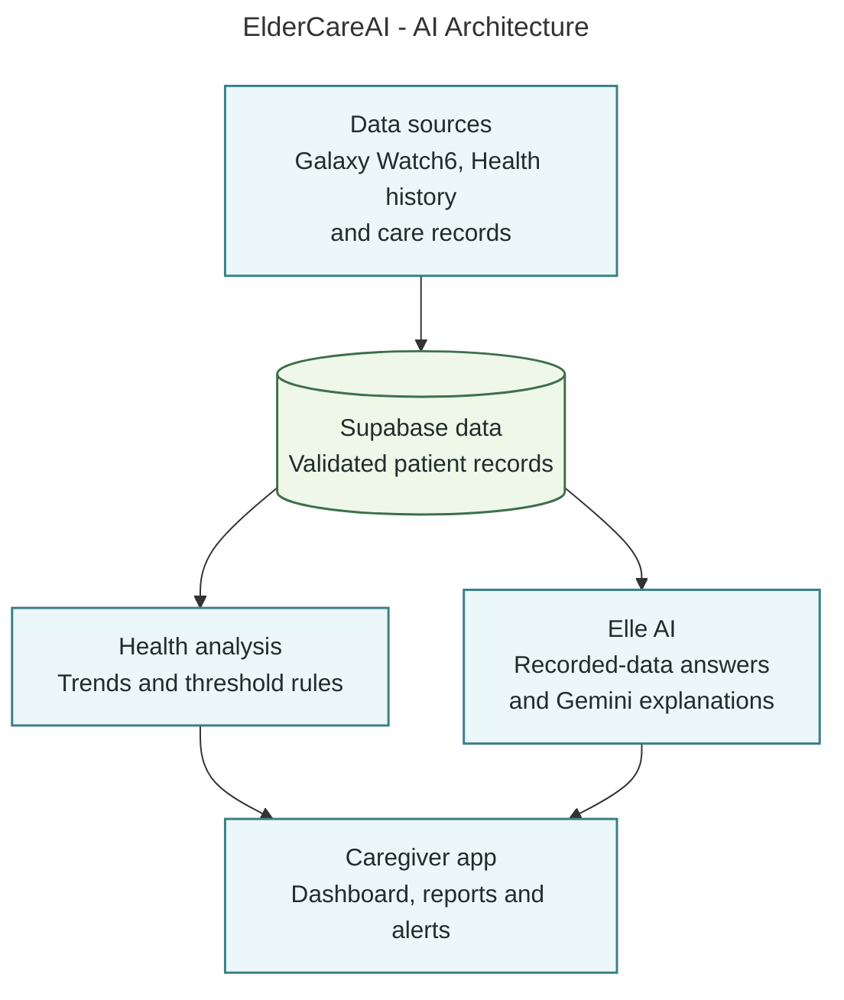
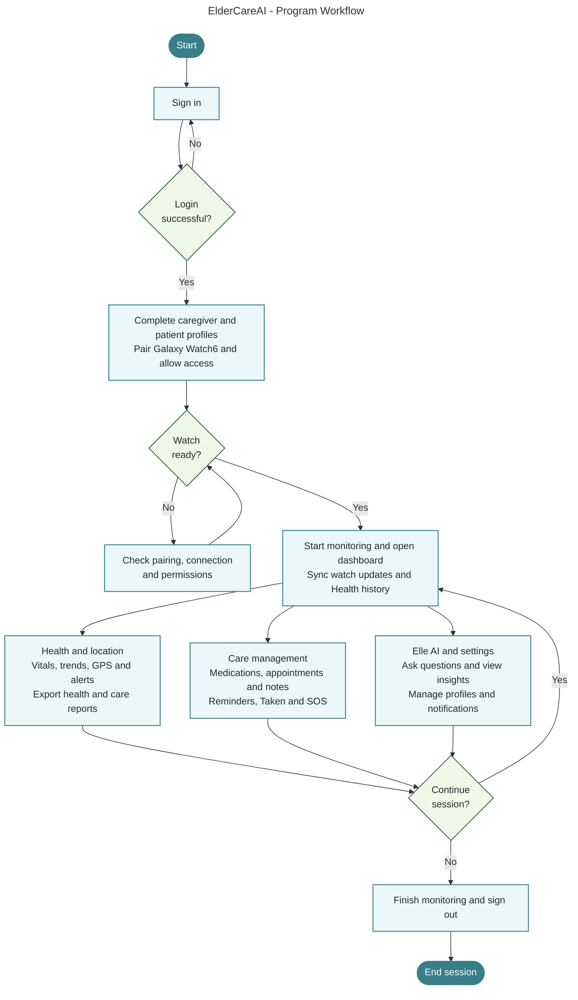
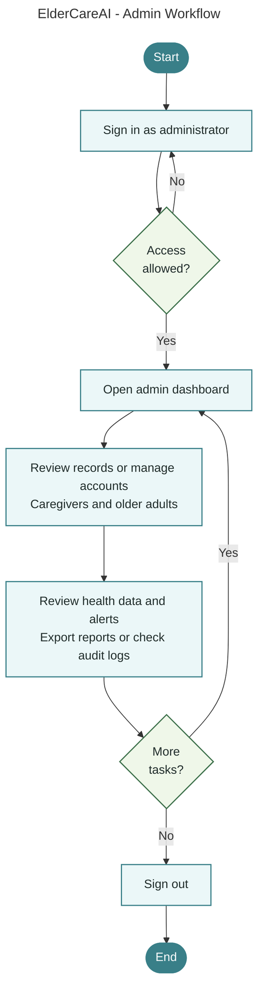
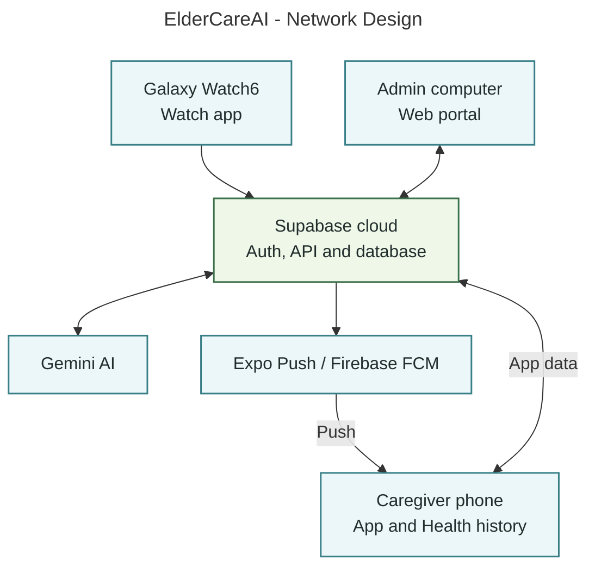
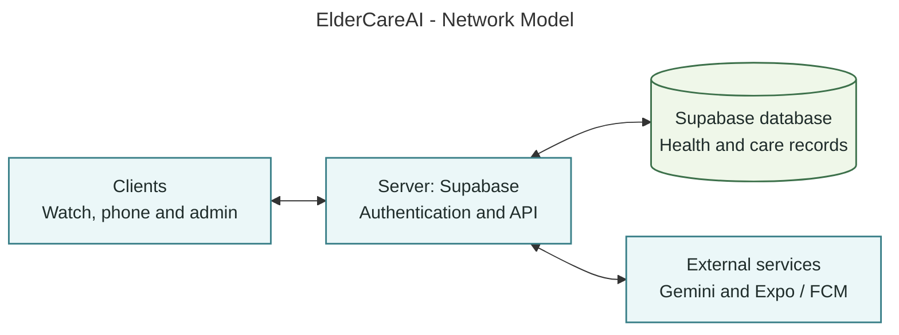
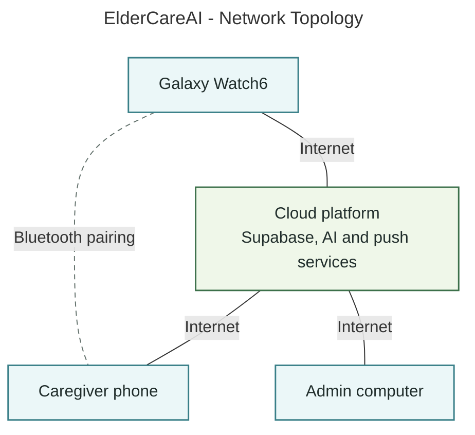

# ElderCareAI - Six Revised Diagram Codes

Editable Mermaid sources. Use workflow-config.json for the program/admin workflows and mermaid-config.json for the other diagrams.

## AI Architecture



## Program Workflow



## Admin Workflow



## Network Design



## Network Model



## Network Topology



## mermaid-config.json

```json
{
  "theme": "base",
  "htmlLabels": true,
  "themeVariables": {
    "fontFamily": "Segoe UI, Arial, sans-serif",
    "fontSize": "20px",
    "primaryColor": "#EBF7F8",
    "primaryTextColor": "#202D2B",
    "primaryBorderColor": "#397F88",
    "lineColor": "#65736E",
    "secondaryColor": "#EFF7E9",
    "tertiaryColor": "#F8FAF9",
    "edgeLabelBackground": "#FFFFFF",
    "titleColor": "#202D2B"
  },
  "flowchart": {
    "htmlLabels": true,
    "curve": "linear",
    "nodeSpacing": 46,
    "rankSpacing": 60,
    "padding": 20,
    "wrappingWidth": 400,
    "useMaxWidth": false
  },
  "themeCSS": ".flowchartTitleText { font-size: 27px !important; font-weight: 600 !important; }"
}
```

## workflow-config.json

```json
{
  "theme": "base",
  "htmlLabels": true,
  "themeVariables": {
    "fontFamily": "Segoe UI, Arial, sans-serif",
    "fontSize": "20px",
    "primaryColor": "#EBF7F8",
    "primaryTextColor": "#202D2B",
    "primaryBorderColor": "#397F88",
    "lineColor": "#65736E",
    "secondaryColor": "#EFF7E9",
    "tertiaryColor": "#F8FAF9",
    "edgeLabelBackground": "#FFFFFF",
    "titleColor": "#202D2B"
  },
  "flowchart": {
    "htmlLabels": true,
    "curve": "linear",
    "nodeSpacing": 36,
    "rankSpacing": 28,
    "padding": 10,
    "wrappingWidth": 400,
    "useMaxWidth": false,
    "minNodeWidth": 0
  },
  "themeCSS": ".flowchartTitleText { font-size: 27px !important; font-weight: 600 !important; }"
}
```
